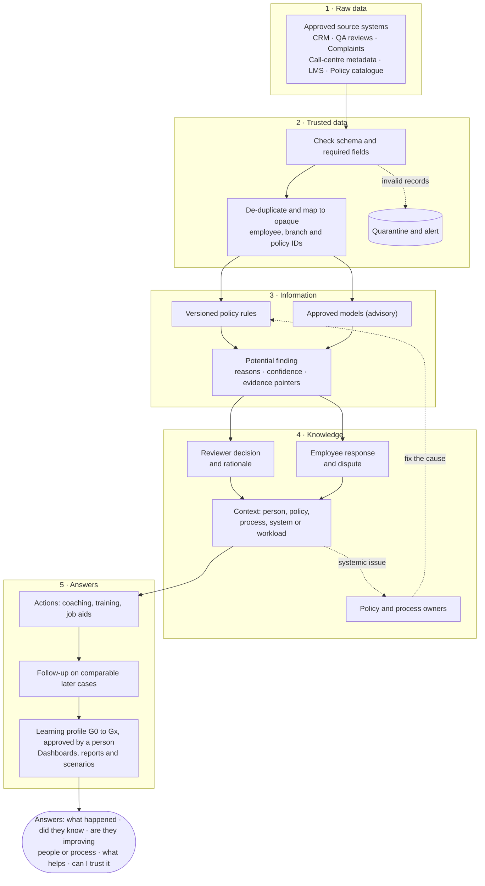

# How data flows: from raw records to answers

BOP Evolve turns raw, messy records from approved source systems into trusted data, then information, then reviewed knowledge, and finally answers that lead to action. The same story is shown, animated and with live numbers, on the **How Data Flows** page of the app and as the animation on the sign-in screen.

## What changes at each step

| Stage | State of the data | What is added | Guardrail |
|---|---|---|---|
| 1 · Collect | **Raw**: messy, incomplete, mixed formats | Source system, extraction time, batch ID | Only approved sources are enabled; no customer content is copied |
| 2 · Validate | **Trusted**: schema-valid, unique, mapped | Opaque IDs, policy version in force on the event date | Invalid records are quarantined and alerted, never silently dropped |
| 3 · Detect | **Information**: a potential finding | Rule and policy version, expected vs observed action, confidence, limitations | Outputs are advisory; a finding stays *potential* until a person reviews it |
| 4 · Review | **Knowledge**: a decided finding in context | Reviewer rationale, employee awareness and dispute, contributing factor | Self-reported awareness, reviewer assessment and demonstrated learning stay separate |
| 5 · Learn | **Answers and action**: outcomes over time | Actions with evidence, follow-up results, learning-profile versions, aggregates | Privacy thresholds on aggregates; no single score decides anything about a person |

## Follow one record

This is the example shown in the app (synthetic data).

| Stage | The record |
|---|---|
| Raw | `{"src":"QA","key":"E-1001-00141","type":"account_opening","ts":"2026-10-24T12:27Z","id_check":"after_activation"}` |
| Trusted | Schema valid, not a duplicate. Mapped to employee E-1001, North Branch 01 · Tellers. Policy KYC-01 v1.1 was in force on that date. |
| Information | Potential finding, rule `KYC_DOC_CHECK` v2. Expected: verify the ID document before activating the account. Observed: verification recorded after activation. Confidence 80 %. |
| Knowledge | Employee: "I was unsure." Reviewer: confirmed; policy clear, evidence supports, factor is process design. |
| Answers | Coaching and a job aid agreed and completed. 0 recurrences in 6 comparable cases. Learning profile proposed to advance to G4 Practice; a manager approves it. |

## Questions each part answers

| Question | Where in the app |
|---|---|
| What happened, and why was it flagged? | Mistake Explorer → case detail |
| Did the employee know it was a mistake? | Case detail: the three separate states |
| Is the person improving over time? | Employee Learning |
| Is it a people, policy or process problem? | Team & Branch Insights (systemic share) |
| Which intervention is likely to help most? | Future Scenarios (illustrative) |
| Can I trust these numbers? | Pipeline & Model Health |

Implementation pointers: ingestion and rules in `backend/app/pipeline/`, review and response workflow in `backend/app/api/cases.py`, learning generations in `backend/app/services/learning.py`, the animation in `frontend/src/components/FlowCanvas.tsx`, and the page in `frontend/src/pages/DataFlow.tsx`.
