# How BOP Evolve works

BOP Evolve runs a **control loop**: a customer-service record becomes a case with procedural facts, approved control rules decide whether it deviates from policy, a person reviews every potential finding after hearing the employee, a corrective action is agreed and checked on later cases, and only then does the employee's development stage move on. The **How BOP Evolve Works** page in the app shows the same loop, animated and with live volumes from your scope, plus a guided tour of one example case.

```mermaid
flowchart LR
  S1["1 · Source systems<br/>core banking · CRM · QA · complaints<br/>contact centre · LMS · policy catalogue"]
  S2["2 · Intake & validation<br/>schema · de-duplication · reference codes<br/>procedural facts extracted"]
  S3["3 · Control rules engine<br/>approved rule versions<br/>evaluated on the facts"]
  S4["4 · Employee account<br/>awareness · circumstances · objection"]
  S5["5 · Independent review<br/>confirm · amend · uphold objection · dismiss<br/>root cause recorded"]
  S6["6 · Corrective action & coaching<br/>owner · due date · evidence"]
  S7["7 · Follow-up on later cases"]
  S8["8 · Development stage approval<br/>G0 Baseline → G5 Sustained performance"]
  S9["9 · Management information<br/>overview · unit performance · planning · reports"]

  Q[("Quarantined")]
  C(["Compliant — no finding"])
  D(["Dismissed / objection upheld"])
  PO["Policy Owner<br/>drafts rule & policy versions"]
  AP["Second approver<br/>four-eyes · backtest first"]

  S1 --> S2 --> S3 --> S4 --> S5 --> S6 --> S7 --> S8 --> S9
  S2 -. invalid record .-> Q
  S3 -. no rule matched .-> C
  S5 -. not upheld .-> D
  S7 -. repeat re-opens the cycle .-> S4
  S9 -. systemic cause .-> PO
  PO --> AP --> S3
```

## The nine steps

| # | Step | What happens | Who | Control | Output |
|---|---|---|---|---|---|
| 1 | Source systems | Read-only connectors collect structured metadata from approved systems. No customer content is copied. | System owners, Data & IT Ops | Only approved sources are enabled; each feed has a freshness service level. | Raw records |
| 2 | Intake & validation | Schema checks, de-duplication, internal reference codes for employee/branch/policy, and extraction of the **procedural facts** the rules need (amounts, approvals, timings). | Automated, monitored by Data & IT Ops | Malformed records are quarantined with a reason and an alert, never silently dropped. | Validated case with facts |
| 3 | Control rules engine | Every rule in force for the service type is evaluated on the facts. A match raises a *potential* finding citing the rule version, policy version and the exact facts. | Rules drafted by Policy Owners, approved by Risk & Compliance | Only approved versions run; each was backtested before going live. Early-warning indicators never raise findings. | Compliant case, or potential finding |
| 4 | Employee account | Before feedback, the employee records awareness of the requirement, circumstances and any objection. | The employee | Recorded separately; never inferred from a score or used to judge intent. | Account and objection on the finding |
| 5 | Independent review | A qualified reviewer confirms, confirms with amendment, upholds the objection or dismisses, and records the root cause. | Branch/section manager or Compliance | No consequence from a potential finding; written rationale; immutable history. | Confirmed or dismissed finding |
| 6 | Corrective action & coaching | An action plan is agreed: coaching, refresher training, job aid, supervised practice, policy clarification or system change request. | Team lead / manager with the employee; HR / L&D | Systemic causes go to the policy or process owner, not the individual. | Completed actions with evidence |
| 7 | Follow-up | Comparable later cases are checked after the settle period. A repeat re-opens the cycle. | Automated | Workload-adjusted; small samples flagged. | Follow-up result |
| 8 | Development stage approval | When evidence gates are met a stage is proposed; a manager approves or rejects it. | Branch manager or HR / L&D | Stages are learning history, not a performance rating or disciplinary input. | Approved, dated stage |
| 9 | Management information | Results feed the executive overview, unit performance, intervention planning and management reports. | Executives, managers, HR, Risk, Audit | Scoped views, privacy thresholds, labelled and audited exports. | Decisions on coaching, policy, process and systems |

## Follow one case

The example used on the page (synthetic data).

| Step | The case |
|---|---|
| Source | A teller at North Branch 01 opens an individual current account at 15:40; core banking records activation and ID-verification times. |
| Intake | Valid, not a duplicate. Employee reference E-1001, North Branch 01 · Tellers. Facts: ID verified before activation = No; waiting time 24 minutes. |
| Rules | `KYC_DOC_CHECK` v2 (policy KYC-01 v1.1) matches. High-severity potential finding, confidence 82 %. |
| Employee account | "I was unsure of the requirement"; circumstances: queue pressure. |
| Review | Confirmed; policy clear, evidence supports. Root cause: process design (the checklist allows activation first). |
| Action | Coaching session and the account-opening job aid for the next 20 cases, both completed within 10 days. |
| Follow-up | 6 comparable account openings in 60 days, no repeat. |
| Stage | E-1001 proposed from G3 Remediation to G4 Application; approved by the branch manager. |
| Management information | 40 % of the branch's KYC findings stem from process design, so the policy owner drafts a revised checklist. |

## Reading the animation

Each moving dot is a case. Its colour shows what it has become: raw record (grey), validated case (blue), potential finding (amber), confirmed finding (burgundy), evidence of improvement (green). Dots leave the loop at the three exits. Exit probabilities follow live data; compliant cases are thinned so findings stay visible, and the step cards show the true proportions. With "reduce motion" enabled, the map is drawn without movement.

## Questions BOP Evolve answers

| Question | Where |
|---|---|
| What happened, and why was it flagged? | Findings Register → case file (rule, policy version, matched facts) |
| Was the employee aware of the requirement? | Case file: employee's account, reviewer's assessment, demonstrated learning |
| Is the employee improving over time? | Staff Development |
| Is it a people, policy or process issue? | Branch & Unit Performance (systemic share) |
| What will a new rule flag, and how often? | Policies & Control Rules (backtest and forecast) |
| Which intervention is likely to help most? | Intervention Planning |
| Can I rely on these figures? | Data & Model Operations |

Implementation pointers: facts and the field catalogue in `backend/app/pipeline/catalogue.py`, evaluation and backtesting in `backend/app/services/rules_engine.py`, the worker in `backend/app/pipeline/worker.py`, the page in `frontend/src/pages/HowItWorks.tsx` and the animation in `frontend/src/components/ProcessMap.tsx`. The sign-in screen keeps its ambient animation (`FlowCanvas.tsx`).
